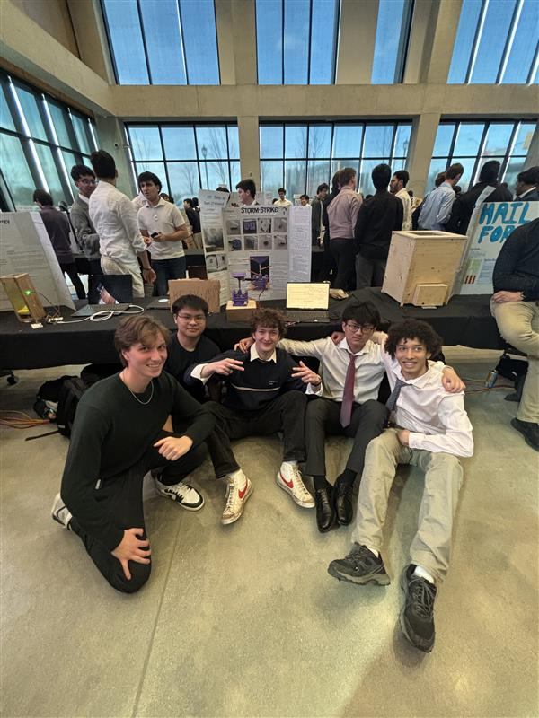

# Hail Impact Data Collection Prototype

**ES 1050 – First-Year Engineering Design Project (Semester 2)**
🏆 *1st place in overall prototype design out of 50+ teams*

---

## Overview

Hailstorms cause billions of dollars in property damage every year. Better data on how hailstones actually strike a surface helps engineers and homeowners design and choose materials that mitigate that damage.

Our team of five was given the following prompt:

> Design a prototype of something that can obtain data that can be used to mitigate damage from hailstone strikes on property.

After a full iterative engineering design process, we built a hail impact sensing system that records impact data during a storm and automatically turns it into easy-to-read graphs.

---

## Final Design

The prototype is built around a **pneumatic cylinder instrumented with a pressure transducer**, mounted to an **impact platform** that can be oriented in 3D:

- **360° rotation** on the XY plane
- **180° rotation** on the Z axis

When a hailstone strikes the platform, the force is transferred to the pneumatic cylinder and the pressure transducer records the resulting pressure change, which serves as the impact measurement.

### Software

A **Python script** handles the data side of the project:

- Records data throughout the storm, processed via **Arduino UNO**
- **Automatically times out** once data collection is finished
- Analyzes the recorded data
- Plots the results on a graph for easy visualization

---

## Constraints

| Constraint | Value |
|---|---|
| Team size | 5 |
| Maximum budget | $100 (all parts) |
| Prototype material | PLA (3D printed) with custom cut wooden pieces for support |

---

## Results

The design placed **1st overall in prototype design** at the design showcase, out of more than 50 teams working on the same prompt.

---

## Media

<table>
  <tr>
    <td align="center">
       
      <em></em>
    </td>
    <td align="center">
       
      <em></em>
    </td>
  </tr>
  <tr>
    <td align="center">
       
      <em></em>
    </td>
    <td align="center">
       
      <em></em>
    </td>
  </tr>
</table>

---

## Future Work (Version 2)

If we were to build a second version, we would make some key improvements:

1. **Better materials.** PLA was suitable for a prototype, but a final version needs materials with enough toughness to absorb repeated hailstone impacts without failing.
2. **Automatic calibration.** Add motors and supporting firmware so the platform can orient itself automatically, ensuring hailstones strike it at a **perpendicular angle**. This would give more accurate and consistent data readings.
3. **Weather Resistance** Current version obviously does not have any protection against the elements. This would need to be designed for any future version.

---

## Team

*Sunny Lin, Ka Chun Matthew Lee, Felix Lewis, Samuel Lamontagne, Matthew Lambert*

Special thanks to *Julia Finlayson*, the TA that guided us to success.
